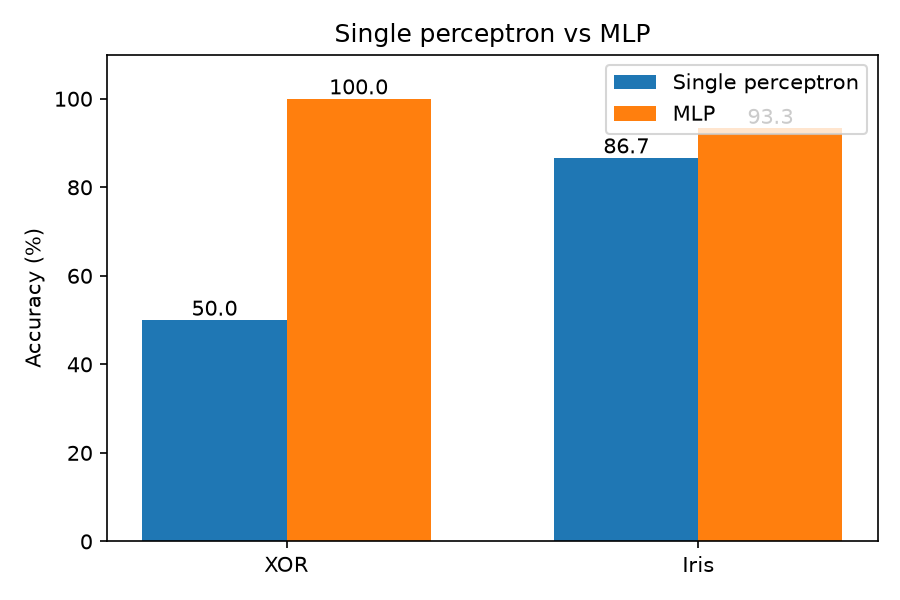

# Single Perceptron vs Multilayer Perceptron (MLP)

This project compares a single-layer perceptron with a multilayer perceptron (MLP). Both are written from scratch with NumPy.

## Models

- **Single perceptron** (`perceptron.py`): one neuron. It can only draw a straight line to separate two classes.
- **MLP** (`mlp.py`): one hidden layer with sigmoid neurons, trained with backpropagation. It can learn curved boundaries.

## Experiments

1. **XOR problem**: the classic example where one straight line is not enough.
2. **Iris dataset** (versicolor vs virginica): a real dataset, using a 70/30 train/test split with scaled features.

## Results

| Problem | Single perceptron | MLP |
|---------|-------------------|-----|
| XOR | 50.0% | 100.0% |
| Iris (test data) | 86.7% | 93.3% |

## Conclusion

The single perceptron fails on XOR because XOR cannot be separated by a straight line. The MLP solves it with a hidden layer. On Iris, the MLP also gives higher accuracy, because the two flower types overlap and need a more flexible boundary.

## How to run

Install the libraries:

    pip install -r requirements.txt

Run the experiments:

    python main.py
    python iris_compare.py
    python plot_results.py

## Files

- `perceptron.py`: single perceptron
- `mlp.py`: multilayer perceptron
- `main.py`: XOR experiment
- `iris_compare.py`: Iris comparison
- `plot_results.py`: makes the results chart
- `requirements.txt`: required libraries